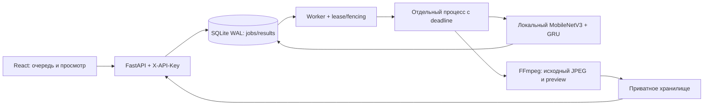

# Архитектура

## Режим одного Windows-ПК

API, UI и медиа имеют один origin; отдельный dev proxy не нужен. Модель и исходные видео не передаются облачному AI. SQLite — источник истины, поэтому рестарт не теряет принятые задания. Невыполненные queued/expired-lease задания доступны worker до общего дедлайна; после него сохраняется failed.

GPU lock, lease token и heartbeat защищают конкурентную обработку и финальный commit. Каждый анализ имеет отдельный процесс. На Windows его дерево включено в Job Object с kill-on-close, чтобы сбой API не оставлял исполняющийся GPU-процесс. Дедлайн включает upload/validation/queue/inference/evidence/preview. Worker concurrency=1; расширение до нескольких API/GPU-хостов этим профилем не поддерживается.

## Модель и честность результата

Используется сохранённый контроль uniform GRU из transition-state-bundle-v1, а не последние ухудшившиеся кандидаты. Один локальный frozen MobileNetV3-Small извлекает признаки; GRU выдаёт общий бинарный вердикт. Веса проверяются по SHA и привязке к коду; runtime ничего не обучает и не скачивает.

Средняя grouped accuracy —71.30%; независимого внешнего теста нет. Исследовательские предметные головы и границы событий ненадёжны. Jury-shaped positive включает общий сигнал классификатора и один настоящий исходный JPEG. Выбор кадра основан на экспериментальных state scores, не на подтверждённой локализации причины вердикта. Источник/пункт нормативного акта к такому сигналу не приписывается.

UI/model status=`prototype`,trained=true,validated=false,test_only=false. Только native PrototypeUpload принимает такой пакет. Исходный production UploadService его отклоняет: ready по-прежнему требует trained+validated non-test release. Synthetic fixtures доступны отдельным тестам/демо и не подставляются при сбое модели.

## Распределённый вариант

backend/app, infra/compose.yaml и PostgreSQL/Redis/Celery сохранены. Его контракт долговечности, POSIX lock/fsync, prefork deadlines, offline worker и TLS остаются самостоятельным вариантом. Новый native-профиль не служит доказательством его приёмки. Для переноса исследовательской модели в этот путь нужна отдельная событийная интеграция; нельзя просто поставить validated=true в manifest.
